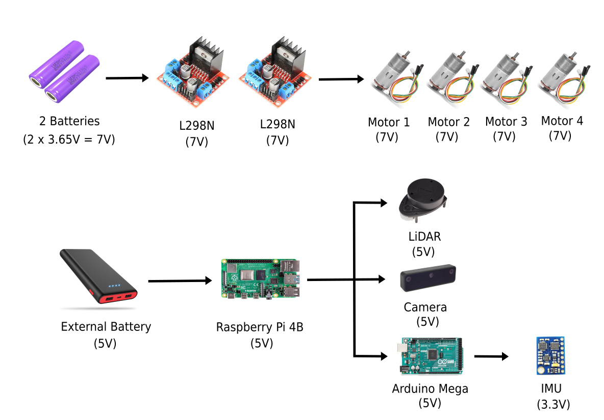
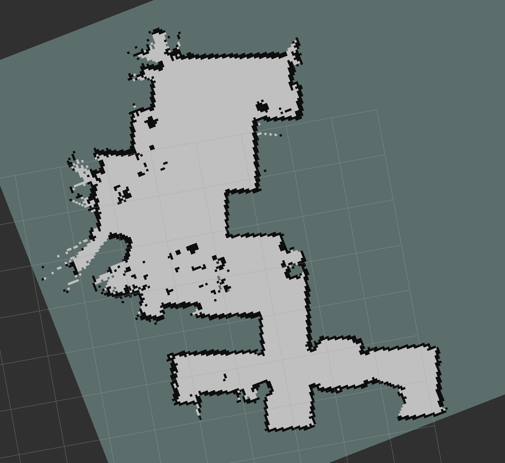
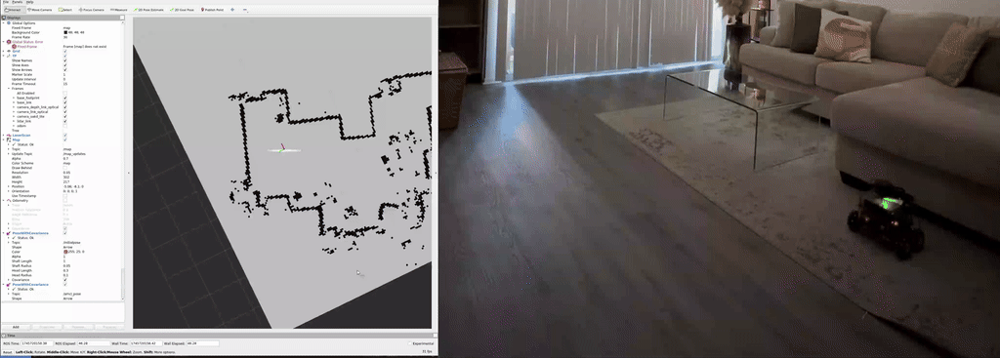
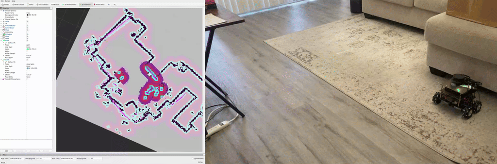

# This repository holds all the development work related to the KouBot Project done by me.

# Table of Contents
 - [About](#about)
    - [Project Goals](#project-goals)
    - [Key Features](#key-features)
    - [Power System](#power-system)
 - [Teleoperation](#teleoperation)
 - [Mapping](#mapping)
 - [Localization](#teleoplocalizationeration)
 - [Autonomous Navigation](#autonomous-navigation)
 - [Next](#next)

# About 

  

 

Welcome to the <em>Koubot</em> project repository! <em>Koubot</em>  is an ambitious project aimed at developing an autonomous mobile robot equipped with **four mecanum wheels**, each powered by its own motor. This unique wheel configuration allows for omnidirectional movement, making <em>Koubot</em> highly maneuverable and capable of navigating complex environments with ease.

 

## Project Goal

Design and build an affordable, ROS 2-based indoor robot with full autonomous navigation capabilities, leveraging Docker for reproducibility and portability.

## Key Features

* **Computer**: Raspberry Pi Model B.

* **Software**: ROS 2 Galactic, Docker container, Gazebo, RViz.

* **Sensors**: LiDAR (RPLIDAR-A1M8 by Slamtec), Depth camera (OAK-D Lite), IMU (Adafruit - BNO055).

* **Mecanum Wheel Configuration**: Each of the 4 wheels is driven by its own motor, enabling omnidirectional movement for versatile navigation.

* **Sensor Fusion**: Integrates data from IMU and wheel encoders to improve odometry and overall navigation accuracy.

## Power System

 

The power system of <em>Koubot</em> is divided into two sections to ensure efficient and reliable operation:

* **Motor Power Supply**: This section is dedicated to powering the 4 motors that drive the mecanum wheels, providing the necessary torque and control for movement.

* **System Power Supply**: This section powers the computer and sensors, ensuring stable and continuous operation of the robot's processing and sensing capabilities.

# Teleoperation

  

*KouBot* supports manual control through a Bluetooth-connected PS4 controller, allowing for smooth and precise holonomic movement in all directions. This setup was essential for early testing, calibration, and validating motor functionality before implementing full autonomy.

# Mapping

  

Using SLAM Toolbox, KouBot was able to construct accurate 2D maps of its environment in real time.

Here is the resulting map:

  

# Localization

  

*KouBot* currently performs localization using LiDAR-based scan matching. In the future, IMU data will be fused with LiDAR-derived odometry using an Extended Kalman Filter (EKF) to enhance robustness and accuracy.

# Autonomous Navigation

  

*KouBot* uses the ROS 2 Nav2 stack to navigate point-to-point, avoiding obstacles and reaching goals with high precision.

# Next

While KouBot has proven its core SLAM and navigation capabilities, future improvements will focus on:

* Integrating full-state localization using an Extended Kalman Filter (EKF) to fuse LiDAR and IMU data.
* Planning to integrate a depth camera (OAK-D) for object detection and image processing experiments.
* Refining the motion controller with feedback from wheel encoders.